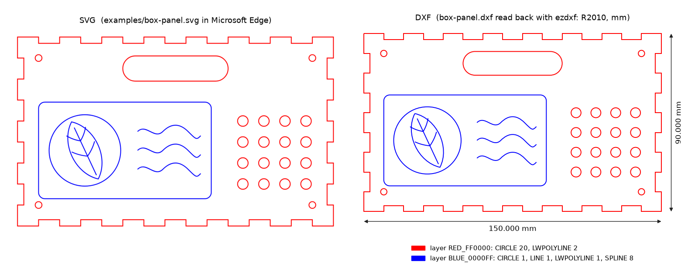

# svg-to-dxf: convert SVG to DXF with the right size, real curves and layers

[](https://github.com/Shahnawaz75/svg-to-dxf/actions/workflows/ci.yml)
[](LICENSE)

**svg-to-dxf** is a free, offline Python tool to convert SVG to DXF for laser cutting, CNC and AutoCAD: drawings from Inkscape, Illustrator or Figma keep their real size in mm (or inches), their curves stay real curves, and their colors become layers.



*Left: `examples/box-panel.svg` rendered by Microsoft Edge. Right: the DXF written by `svg-to-dxf`, read back and drawn with ezdxf, with its measured size. Made by [`scripts/make_screenshot.py`](scripts/make_screenshot.py).*

```text
$ svg-to-dxf box-panel.svg --report
box-panel.svg -> box-panel.dxf
  DXF R2010 (AC1024), units mm ($INSUNITS=4)
  size      150.000 x 90.000 mm  (5.906 x 3.543 in)
  extents   X 5.000 .. 155.000   Y 5.000 .. 95.000
  layer        entities  closed  open  types
  RED_FF0000         22      22     0  CIRCLE 20, LWPOLYLINE 2
  BLUE_0000FF        11       3     8  CIRCLE 1, LINE 1, LWPOLYLINE 1, SPLINE 8
  total              33      25     8
  warnings:
    - 1 hidden or unpainted element(s) skipped (display:none, visibility:hidden, opacity 0, or no stroke and no fill); use --include-hidden to export them
```

## Why

Turning an SVG into a DXF sounds trivial until the file reaches the laser, the CNC or AutoCAD:

- **Wrong size.** px vs mm, 96 vs 72 DPI, a `viewBox` that scales everything. svg-to-dxf reads the root `width`/`height` units and the `viewBox`, writes `$INSUNITS`, and prints the final size so you can check it before cutting.
- **Curves turned into thousands of tiny lines** (or lost). Bezier curves become exact DXF `SPLINE`s, circles become `CIRCLE`, arcs become `ARC` or polyline bulges, ellipses become `ELLIPSE`. If your software wants lines, you choose the tolerance.
- **Transforms ignored.** Every nested `translate`/`rotate`/`scale`/`skew`/`matrix` is applied exactly; a skewed circle becomes the exact ellipse.
- **Shapes that should be closed aren't.** Closed SVG paths become closed entities, and `--join` stitches touching open pieces.
- **Everything on one layer.** Stroke colors (red = cut, blue = engrave, ...) become layers, or use your Inkscape layers.
- **"Invalid DXF" in older laser software.** `--laser` writes R12 with plain polylines.
- **Upside down.** Y is flipped so the drawing is upright in CAD, with (0, 0) at the bottom-left of the page.
- **Online converters upload your designs.** This runs on your computer and sends nothing anywhere.

## Install

Python 3.10 or newer:

```bash
pip install git+https://github.com/Shahnawaz75/svg-to-dxf
```

It builds on [svgelements](https://github.com/meerk40t/svgelements) (SVG parsing with CSS, transforms and units) and [ezdxf](https://github.com/mozman/ezdxf) (DXF writing). A PyPI package is coming soon.

## Quick start

```bash
svg-to-dxf drawing.svg                     # -> drawing.dxf: mm, DXF R2010, exact curves, layers by color
svg-to-dxf drawing.svg --report            # also print size, extents and entities per layer
svg-to-dxf drawing.svg --laser             # R12 + polylines + joined paths, for laser software
svg-to-dxf drawing.svg -o out/part.dxf     # choose the output file
python -m svg_to_dxf drawing.svg           # same thing without the console script
```

Run `svg-to-dxf --help` for every option. Skipped content (text, hidden elements, images, gradients, clip paths) is reported with a warning.

## Get the size right (units, DPI, viewBox)

The root `<svg>` element decides the real-world size:

| SVG root element | DXF size |
| --- | --- |
| `width="100mm" height="50mm" viewBox="0 0 1000 500"` | 100 x 50 mm (the viewBox is scaled to fit) |
| `width="4in" height="2in"` | 101.6 x 50.8 mm |
| `width="400" height="200"` (px or no unit) | 105.833 x 52.917 mm at 96 DPI, 141.111 x 70.556 mm with `--dpi 72` |
| `viewBox="0 0 24 24"` only (typical icon) | 24 px = 6.35 mm |

- Physical units (`mm`, `cm`, `in`, `pt`, `pc`) are exact and never depend on DPI.
- `--dpi` only matters for px/unitless sizes: **96** (default) matches Inkscape 0.92+ and browsers, **72** matches files where 1 px = 1 pt (common in Illustrator exports), **90** matches Inkscape 0.91 and older.
- `--units in` writes inches instead of millimetres and sets `$INSUNITS` accordingly.
- `--scale 2` multiplies the size; `--fit-width 200mm` (or `--fit-height 3in`) scales the drawing to an exact size.
- `--origin` chooses what lands on DXF (0, 0): `bottom-left` of the page (default), `top-left`, `center`, or `bbox` (bottom-left of the drawing itself).

The full explanation, with the numbers behind typical "my DXF is 3.78x / 1.33x too big" problems, is in [docs/units-and-scale.md](docs/units-and-scale.md).

## Curves: splines or polylines

`--curves spline` (default) keeps every curve exact:

- Cubic and quadratic Bezier segments become a DXF `SPLINE` with a clamped knot vector whose interior knots have full multiplicity, so the spline **is** the Bezier curve: its control points are the SVG control points. A path made of several segments becomes one spline (degree 3, or degree 2 if it only has quadratics).
- Circles become `CIRCLE`, circular arcs become `ARC` (or bulges inside a polyline), ellipses and elliptical arcs become `ELLIPSE`, straight runs become `LWPOLYLINE`.
- An arc that shares a path with Bezier curves is written as cubic spans of at most 30 degrees (error below 4e-7 of the radius).

`--curves polyline --tolerance 0.05` flattens Bezier curves and ellipses into polylines whose maximum deviation from the true curve is guaranteed to stay below the tolerance (in output units, default 0.05 mm). Circular arcs stay exact as polyline bulges.

## Layers from colors or Inkscape layers

- `--layers color` (default): one layer per stroke color, named like `RED_FF0000` or `BLUE_1E88E5`, with the exact DXF true color and the nearest AutoCAD Color Index (ACI). Shapes without a stroke use their fill color.
- `--layers group`: one layer per Inkscape layer (`inkscape:label`), or per top-level `<g>` (its `data-name` or `id`) for Illustrator and Figma files. Entities keep their colors.
- `--layers none`: everything on layer `0`, colors kept on the entities.
- `--fill-as-hatch` also exports filled shapes as solid `HATCH` entities.
- Invisible elements (`display:none`, `visibility:hidden`, zero opacity, no stroke and no fill) are skipped and counted; `--include-hidden` exports them.

## For laser cutters (the --laser preset)

`--laser` is shorthand for `--dxf-version R12 --curves polyline --join --units mm`: the oldest, most widely readable DXF dialect, curves as plain polylines, and touching pieces joined into continuous paths. Explicit options still win, e.g. `--laser --dxf-version R2000`.

```text
$ svg-to-dxf box-panel.svg --laser -o box-panel-laser.dxf --report
box-panel.svg -> box-panel-laser.dxf
  DXF R12 (AC1009), units mm
  size      150.000 x 90.000 mm  (5.906 x 3.543 in)
  extents   X 5.000 .. 155.000   Y 5.000 .. 95.000
  layer        entities  closed  open  types
  RED_FF0000         22      22     0  CIRCLE 20, POLYLINE 2
  BLUE_0000FF         9       3     6  CIRCLE 1, LINE 1, POLYLINE 7
  total              31      25     6
  changes:
    - 6 curved path(s) flattened to polylines within 0.05 mm (R12 has no SPLINE)
    - 9 polyline(s) written as POLYLINE (R12 has no LWPOLYLINE)
    - R12 stores no drawing units: import the file as mm
  warnings:
    - 1 hidden or unpainted element(s) skipped (display:none, visibility:hidden, opacity 0, or no stroke and no fill); use --include-hidden to export them
```

Tips for cut and engrave colors, kerf, and importing into LightBurn, RDWorks and LaserGRBL: [docs/laser-cutting.md](docs/laser-cutting.md).

## DXF versions (R12 vs R2010)

`--dxf-version R12|R2000|R2010|R2018` (default R2010). Every output passes ezdxf's audit in the test suite.

| | R12 | R2000 | R2010 (default) | R2018 |
| --- | --- | --- | --- | --- |
| Polylines | `POLYLINE` | `LWPOLYLINE` | `LWPOLYLINE` | `LWPOLYLINE` |
| Bezier curves | flattened `POLYLINE` | `SPLINE` | `SPLINE` | `SPLINE` |
| Ellipses | flattened `POLYLINE` | `ELLIPSE` | `ELLIPSE` | `ELLIPSE` |
| Circles, arcs | `CIRCLE`, `ARC`, bulges | same | same | same |
| `--fill-as-hatch` | not available | `HATCH` | `HATCH` | `HATCH` |
| Colors | ACI only | ACI only | ACI + true color | ACI + true color |
| Units (`$INSUNITS`) | not stored in R12 | yes | yes | yes |

Whenever the chosen version changes something, the tool says what it changed.

## Batch convert a folder

```bash
svg-to-dxf designs/ -o dxf/              # every .svg and .svgz in designs/ -> dxf/*.dxf
svg-to-dxf designs/ -o dxf/ --recursive  # include subfolders (mirrored under dxf/)
svg-to-dxf a.svg b.svg c.svg -o dxf/     # a list of files
```

A file that fails is reported and the others still convert. Exit code: `0` when everything converted, `2` on any error.

## Python API

```python
from svg_to_dxf import convert

result = convert("box-panel.svg", "box-panel.dxf", units="mm")
print(result.size)      # (150.0, 90.0)
print(result.report())  # the same text as --report
doc = result.doc        # the ezdxf document, e.g. to add a title block and save again

convert("logo.svg", "logo-laser.dxf", laser=True, fit_width="80mm")
```

Every CLI option is a keyword argument (`dpi`, `scale`, `fit_width`, `origin`, `curves`, `tolerance`, `join`, `layers`, `fill_as_hatch`, `include_hidden`, `text`, `dxf_version`), or pass a `ConvertOptions` object. `output=None` builds the document without saving. Sources can be a path, raw bytes or a binary file object; `.svgz` works too.

## How it works

1. **Parse.** [svgelements](https://github.com/meerk40t/svgelements) reads the SVG: CSS styles, inherited attributes, units, the `viewBox`, and `<use>` references. Shapes keep their local geometry plus one accumulated transform matrix. Physical units are converted with exact factors (1 in = 25.4 mm, 1 pt = 1/72 in) and the `viewBox` mapping is rebuilt at full precision, so a 100 mm SVG is 100.000000 mm in the DXF.
2. **Transform exactly.** Bezier control points are transformed directly. Elliptical arcs are stored as `center + u*cos(t) + v*sin(t)`, a form that stays exact under any affine transform, so rotated, mirrored and skewed arcs and circles come out exact. A final similarity transform flips Y, scales to mm or inches and moves the origin.
3. **Choose entities.** Full circles (including paths made of arcs) become `CIRCLE`; arcs become `ARC`/bulges; ellipses become `ELLIPSE`; Bezier paths become one clamped B-spline per subpath; straight runs become polylines. Flattening uses Wang's formula, which bounds the deviation instead of guessing a segment count.
4. **Write and check.** [ezdxf](https://github.com/mozman/ezdxf) writes the DXF; the report measures the bounding box of the written entities. The test suite reads every output back with ezdxf, runs `doc.audit()`, and compares geometry against known answers.

## Limitations

- **Text is not converted to outlines.** DXF cannot carry SVG fonts reliably. By default text is skipped with a warning; `--text dxf` writes best-effort `TEXT` entities at the right position and height, but font, kerning and letter spacing are not preserved. Convert text to paths first for cutting.
- **Stroke width is ignored.** Strokes become centerlines, as CAD and laser software expect; a thick stroke is not turned into an outline.
- **Not supported:** filters (ignored); gradients and patterns (the shape is exported in black, with a warning); masks and clip paths (the unclipped shapes are exported, with a warning); markers such as arrowheads (not drawn); embedded raster images (ignored, with a warning).
- `<symbol>` viewBox scaling inside `<use>` is not applied, and CSS support is what svgelements offers (tag, `.class` and `#id` selectors).
- `--fill-as-hatch` uses DXF odd-parity filling, which can differ from SVG `fill-rule="nonzero"` for overlapping shapes drawn in the same direction.
- Closed Bezier paths become splines whose last control point equals the first; they are geometrically closed but do not carry DXF's "periodic" flag.
- R12 files cannot store units or true colors; very large curved drawings in R12 can take a few seconds to write because R12 stores every polyline vertex as its own entity.
- Output is validated with ezdxf (audit and geometry read-back); it has not been tried in every CAD or laser program. Please open an issue if a program rejects a file.

## FAQ

### How do I convert SVG to DXF for laser cutting?

Install it, then run `svg-to-dxf design.svg --laser --report`. You get an R12 DXF in millimetres with plain polylines and joined paths, one layer per color, and a printed size to compare with your design before cutting. See [docs/laser-cutting.md](docs/laser-cutting.md).

### Why is my DXF the wrong size after converting from SVG?

Usually the SVG size is in px and the converter assumed the wrong pixels-per-inch, or the `viewBox` was ignored, or the importing program assumed inches. svg-to-dxf uses the units on the root element and the `viewBox`, defaults to 96 px per inch for px values (`--dpi 72` or `--dpi 90` for other exporters), and writes `$INSUNITS`. Off by 3.78x? That is px vs mm. Off by 1.33x? 96 vs 72 DPI. Off by 25.4x? An inch/mm mix-up at import. Details: [docs/units-and-scale.md](docs/units-and-scale.md).

### Why are curves made of many small lines?

Many converters flatten every Bezier curve into short line segments. svg-to-dxf writes exact `SPLINE`, `ARC`, `CIRCLE` and `ELLIPSE` entities by default. If your software needs lines, `--curves polyline --tolerance 0.02` gives you control over how close the lines follow the curve.

### How do I keep colors/layers when converting SVG to DXF?

That is the default: each stroke color becomes a layer named like `RED_FF0000`, with the exact true color and the nearest ACI color. Use `--layers group` to get one layer per Inkscape layer or top-level group instead.

### Is it safe for private designs?

Yes. svg-to-dxf runs entirely offline on your own computer. Nothing is uploaded, and it makes no network requests.

### Does it convert text?

Not as outlines. Fonts cannot be embedded in DXF in a portable way, so text is skipped with a warning that says how many text elements were found. Convert text to paths in your editor first (Inkscape: Path > Object to Path; Illustrator: Type > Create Outlines), or use `--text dxf` to get editable `TEXT` entities at the right position and height.

## Contributing

Bug reports with a small SVG that shows the problem are the most useful contribution. See [CONTRIBUTING.md](CONTRIBUTING.md) for the development setup; the tests run with `pytest`.

## See also

- [dxf-diff](https://github.com/Shahnawaz75/dxf-diff): compare two DXF files and see what changed between revisions.
- [dxf-takeoff](https://github.com/Shahnawaz75/dxf-takeoff): quantity takeoff from DXF drawings.

## License

[MIT](LICENSE)

If svg-to-dxf saved you time, a star on GitHub helps other makers find it.
