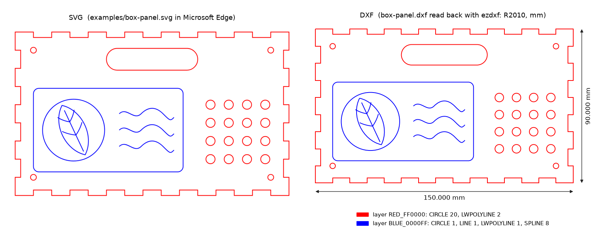

# svg-to-dxf

**Convert SVG to DXF with the right size, real curves and layers.** svg-to-dxf is a free, open source Python command-line tool for makers, laser cutting and CNC users and CAD users. It turns SVG files from Inkscape, Illustrator, Figma or icon sets into clean DXF files for laser software, CAM programs and AutoCAD, on your own computer, without uploading anything.



## What it does

- **Right size:** reads the SVG `width`, `height` and `viewBox` with their units (mm, cm, in, pt, pc, px) and writes millimetres or inches with `$INSUNITS`. `--dpi` handles 96 vs 72 px per inch.
- **Real curves:** Bezier curves become exact DXF splines, circles become circles, arcs become arcs, ellipses become ellipses. Or flatten to polylines within a tolerance you choose.
- **Layers:** one layer per color (cut red, engrave blue) or one per Inkscape layer.
- **Compatible:** DXF R12, R2000, R2010 or R2018. `--laser` writes R12 polylines for older laser software.
- **Checkable:** `--report` prints the size, extents and entity counts per layer.

## Install and run

```bash
pip install git+https://github.com/Shahnawaz75/svg-to-dxf
svg-to-dxf design.svg --report
```

Requires Python 3.10 or newer. A PyPI package is coming soon.

## Guides

- [Units and scale](units-and-scale.md): px vs mm, DPI, viewBox, and fixing a DXF with the wrong size.
- [Laser cutting](laser-cutting.md): cut and engrave colors, kerf, R12, and import tips for LightBurn, RDWorks and LaserGRBL.

## Links

- Source code, issues and the full README: [github.com/Shahnawaz75/svg-to-dxf](https://github.com/Shahnawaz75/svg-to-dxf)
- License: MIT
